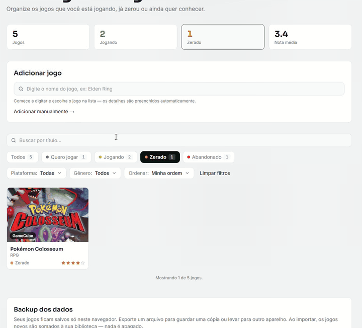
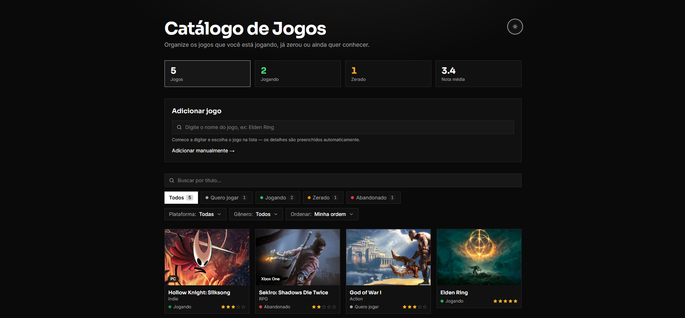
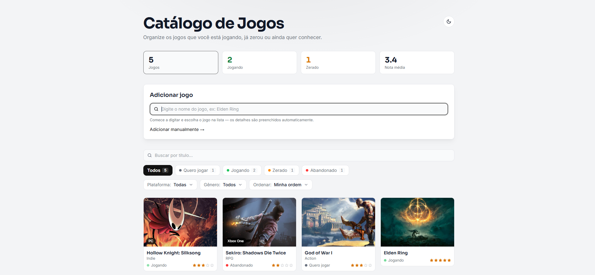
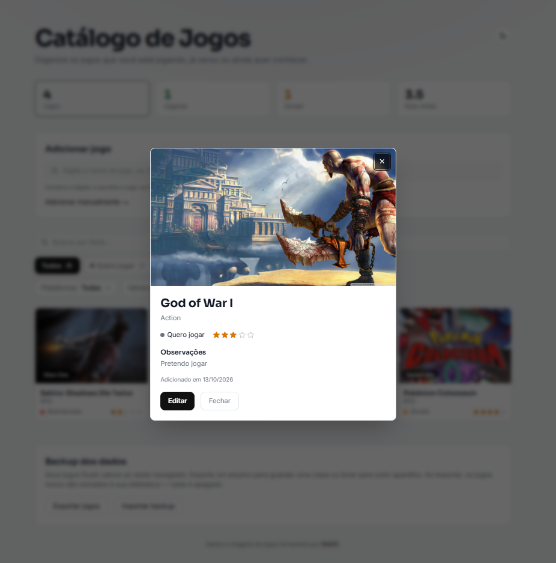

<h1 align="center">🎮 Catálogo de Jogos v2</h1>

<p align="center">
  <a href="https://github.com/VictorStavarengo/crud-jogos-v2/actions/workflows/ci.yml"></a>
  <a href="https://crud-jogos-v2.vercel.app"></a>
  <a href="LICENSE"></a>
  
  
  
  
</p>

<p align="center">
  Organize os jogos que você quer jogar, está jogando, já zerou ou abandonou.<br />
  Reconstrução do meu primeiro projeto, agora com TypeScript, testes automatizados e uma arquitetura organizada.
</p>

<p align="center">
  <a href="https://crud-jogos-v2.vercel.app"><strong>▶ Ver demo ao vivo</strong></a>
</p>



---

## 📖 Sobre o projeto

Aplicativo CRUD para montar uma biblioteca pessoal de jogos. Busca dados em tempo real na [RAWG.io](https://rawg.io/apidocs) para autocompletar o cadastro (ou permite cadastrar manualmente, sem a API) e guarda tudo no navegador, com backup em arquivo.

É a segunda versão de um catálogo que eu já tinha feito em JavaScript puro (veja o [projeto original](https://github.com/VictorStavarengo/crud-jogos)). Refiz do zero para:

- migrar para **TypeScript**, com tipagem no domínio (`Game`), nos serviços e nos componentes;
- separar responsabilidades em `hooks`, `services`, `types`, `utils` e `components`, em vez de um único arquivo grande;
- adicionar **testes automatizados** e integração contínua;
- ter uma identidade visual própria (paleta, tipografia e tema claro/escuro), em vez do Tailwind padrão.

---

## 📸 Telas

| Tema escuro | Tema claro |
| --- | --- |
|  |  |

<p align="center">
  
</p>

---

## ✨ Recursos

- **Cadastro** com autocomplete da RAWG ou manual, com validação e aviso de jogo duplicado (mesmo nome na mesma plataforma).
- **Plataforma e gênero:** ao escolher um jogo da RAWG, todas as opções dela viram botões (ou digite a sua). O app já vem com a plataforma e o gênero que você mais usa na biblioteca, quando existem entre as opções do jogo.
- **Cards** com capa, gênero, plataforma, status e nota em estrelas; clique no título para abrir os detalhes e no status para avançá-lo (Quero jogar → Jogando → Zerado → Abandonado).
- **Arrastar e soltar** para reordenar, com mouse, toque e teclado, disponível na ordenação "Minha ordem".
- **Filtros** por busca (sem acento), status, plataforma e gênero; **ordenação** por mais recentes, nome ou maior nota.
- **Backup:** exporte a biblioteca para um `.json` e importe depois. Com a biblioteca vazia o backup entra direto; se já houver jogos, você escolhe entre **somar** (mantém tudo e ignora repetidos) e **substituir tudo** (pede confirmação e pode ser desfeito).
- **Atalhos de teclado:** `/` foca a busca, `N` começa um novo cadastro e `Esc` limpa a busca.
- **Tema claro e escuro**, com avisos quando o armazenamento do navegador não funciona ou a busca da RAWG está limitada.
- **Acessibilidade:** navegação por teclado, foco visível, janelas com foco preso, listas e menus com semântica correta e anúncios em português ao arrastar.

---

## 🧠 Decisões técnicas

- **Local-first.** Tudo fica no `localStorage`, em formato versionado (`{ version, games }`). Ao carregar, cada item é validado e dados de versões anteriores são migrados (por exemplo, a antiga "nota 0" virou "sem nota"). Se o armazenamento falhar ou estiver corrompido, o app começa vazio em vez de quebrar, e avisa quando não consegue salvar.
- **Regras em funções puras.** Filtros, ordenação, estatísticas, detecção de duplicados, mesclagem de backup e escolha de valores iniciais ficam em `utils/`, testadas sem renderizar nada na tela.
- **Busca resiliente.** `useGameSearch` combina debounce com `AbortController` e tem estados explícitos (ocioso, carregando, sucesso, erro e limite de requisições). Sem chave ou sem internet, o cadastro manual continua disponível.
- **Tokens de design.** Cores e raios vêm de variáveis CSS ligadas ao Tailwind, então os componentes não precisam saber qual tema está ativo.
- **Imagens leves.** As capas da RAWG são pedidas já no tamanho do card, com volta automática para a imagem original se a versão reduzida falhar.
- **Acessibilidade como requisito.** Combobox com teclado, `role="dialog"` com foco preso, radios de verdade para status e nota, e contraste de cor checado nos dois temas.
- **Testes de comportamento.** Além das funções puras, os testes cobrem fluxos completos: adicionar, editar, excluir e desfazer, importar e exportar, atalhos e filtros.

---

## 🚀 Tecnologias

- **React 18 + TypeScript**
- **Vite** — build e servidor de desenvolvimento
- **Tailwind CSS** — estilização com tokens de cor e tipografia próprios (veja `tailwind.config.js` e `src/index.css`)
- **dnd-kit** — arrastar e soltar acessível
- **react-toastify** — avisos
- **Vitest + React Testing Library** — testes de componentes, hooks e funções puras
- **RAWG.io API** — dados e capas dos jogos
- **ESLint** e **GitHub Actions** — padronização e integração contínua
- **Vercel** — hospedagem

---

## 🏗️ Arquitetura

```
src/
├── types/        # Tipos do domínio (Game, GameStatus, GAME_STATUSES...)
├── constants/    # Constantes compartilhadas (cores por status, chaves do storage)
├── services/     # Comunicação com a API externa (RAWG.io)
├── hooks/        # Estado reutilizável (useGames, useLocalStorage, useGameSearch, useHotkeys, useModal...)
├── utils/        # Funções puras: filtros, ordenação, estatísticas, duplicados, backup, formato salvo
├── components/   # Componentes de UI; os principais têm teste ao lado
└── test/         # Configuração do ambiente de testes
```

A lógica de CRUD fica isolada no hook `useGames`, sem depender de nenhum componente, e as regras de negócio ficam em `utils/`.

---

## 💻 Como rodar localmente

```bash
git clone https://github.com/VictorStavarengo/crud-jogos-v2.git
cd crud-jogos-v2
npm install
npm run dev
```

O app abre em `http://localhost:5173`. Requer Node 20 ou mais novo (o repositório usa o 22, veja `.nvmrc`).

### Chave da RAWG (para o autocomplete)

Sem a chave o app funciona normalmente, só com cadastro manual. Para ligar a busca:

1. Crie uma conta gratuita e gere uma chave em [rawg.io/apidocs](https://rawg.io/apidocs).
2. Copie o arquivo de exemplo (Windows PowerShell: `Copy-Item .env.example .env.local`; Mac/Linux: `cp .env.example .env.local`).
3. Preencha a variável no `.env.local`, sem aspas:

   ```
   VITE_RAWG_API_KEY=sua_chave_aqui
   ```

4. Reinicie o `npm run dev` (o Vite só lê o arquivo ao iniciar).

> Variáveis `VITE_*` ficam visíveis no navegador de quem usa o app. Para uma chave gratuita num projeto de portfólio isso é aceitável; nunca coloque aqui uma chave paga ou secreta. O `.env.local` está no `.gitignore`.

---

## ✅ Scripts e qualidade

| Comando | O que faz |
| --- | --- |
| `npm run dev` | Servidor de desenvolvimento |
| `npm run build` | Confere os tipos e gera a versão de produção |
| `npm run preview` | Abre a versão de produção localmente |
| `npm run lint` | ESLint |
| `npm test` | Roda os testes uma vez |
| `npm run test:watch` | Testes em modo observador |
| `npm run check` | Lint + testes + build, tudo em sequência |

O GitHub Actions ([`ci.yml`](.github/workflows/ci.yml)) roda lint, testes e build a cada push na `main` e em pull requests, e o Dependabot abre pull requests semanais com atualizações de dependências.

---

## 🗺️ Próximos passos

- [ ] Login e sincronização da biblioteca entre aparelhos
- [ ] Instalação como app (PWA) e uso offline
- [ ] Gráficos de estatísticas por gênero e plataforma
- [ ] Listas personalizadas (coleções)

Veja o [CHANGELOG](CHANGELOG.md) para o histórico de versões.

---

## 🙏 Créditos

Dados e imagens de jogos fornecidos pela [RAWG](https://rawg.io). Os termos da API gratuita pedem atribuição com link ativo em toda página que usa os dados — por isso o rodapé do app tem esse link.

## 📄 Licença

Distribuído sob a licença MIT. Veja o arquivo [LICENSE](LICENSE).
